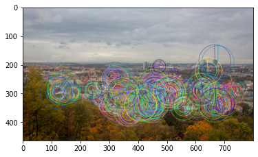
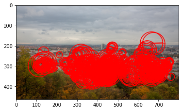
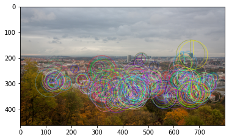

# kornia_moons

Conversions between [kornia](https://github.com/kornia/kornia) and other computer vision libraries formats: OpenCV keypoints ↔ kornia LAFs, matches, and visualization utilities.

**Documentation:** https://ducha-aiki.github.io/kornia_moons/

## Install

```bash
pip install kornia_moons
```

## How to use

Convert OpenCV ORB keypoints to kornia LAFs and back:

```python
import matplotlib.pyplot as plt
import cv2
import kornia as K

from kornia_moons.feature import laf_from_opencv_ORB_kpts, opencv_ORB_kpts_from_laf
from kornia_moons.viz import visualize_LAF

img = cv2.cvtColor(cv2.imread('data/strahov.png'), cv2.COLOR_BGR2RGB)

det = cv2.ORB_create(500)
kps, descs = det.detectAndCompute(img, None)

out_img = cv2.drawKeypoints(img, kps, None, flags=cv2.DRAW_MATCHES_FLAGS_DRAW_RICH_KEYPOINTS)
plt.imshow(out_img)

lafs = laf_from_opencv_ORB_kpts(kps)
visualize_LAF(K.image_to_tensor(img, False), lafs, 0)

kps_back = opencv_ORB_kpts_from_laf(lafs)
out_img2 = cv2.drawKeypoints(img, kps_back, None, flags=cv2.DRAW_MATCHES_FLAGS_DRAW_RICH_KEYPOINTS)
plt.imshow(out_img2)
```







See the [feature tutorial](feature/) and [visualization tutorial](viz/) for more.

## Development

```bash
pip install -e ".[dev]"
pytest tests                                # unit tests
pytest --nbmake docs/feature.ipynb docs/viz.ipynb   # run the docs notebooks
mkdocs serve                                # preview docs locally
```
